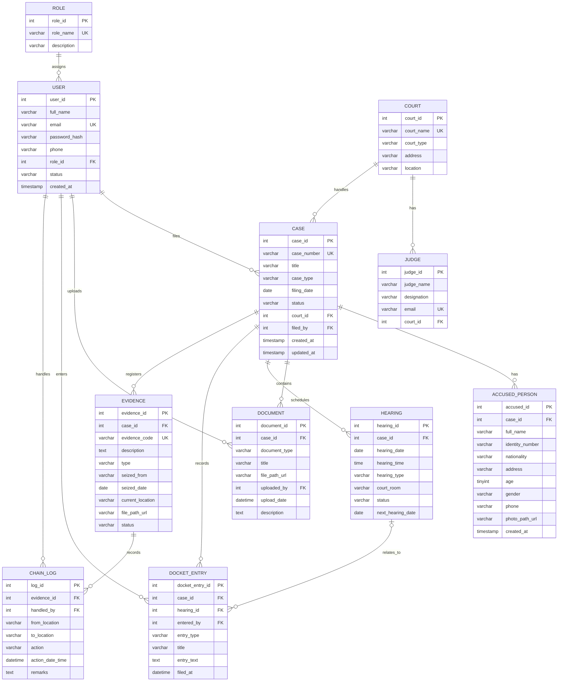

# Judicial Case Filing System — ER Diagram

The diagram below represents the transactional MySQL database. MongoDB is used separately for append-only audit events and case notes, so it is not part of this relational ER model.

## Relationship summary

| Parent | Child | Cardinality | Foreign key |
|---|---|---:|---|
| `role` | `user` | 1 : many | `user.role_id` |
| `user` | `case` | 1 : many | `case.filed_by` |
| `court` | `judge` | 1 : many | `judge.court_id` |
| `court` | `case` | 1 : many | `case.court_id` |
| `case` | `accused_person` | 1 : many | `accused_person.case_id` |
| `case` | `document` | 1 : many | `document.case_id` |
| `user` | `document` | 1 : many | `document.uploaded_by` |
| `case` | `hearing` | 1 : many | `hearing.case_id` |
| `case` | `docket_entry` | 1 : many | `docket_entry.case_id` |
| `hearing` | `docket_entry` | 1 : many (optional on entry) | `docket_entry.hearing_id` |
| `user` | `docket_entry` | 1 : many | `docket_entry.entered_by` |
| `case` | `evidence` | 1 : many | `evidence.case_id` |
| `evidence` | `chain_log` | 1 : many | `chain_log.evidence_id` |
| `user` | `chain_log` | 1 : many | `chain_log.handled_by` |

The `case` table is the central entity. Deleting a case cascades to its accused records, documents, hearings, docket entries, evidence, and chain-of-custody logs according to the schema constraints.
